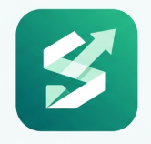
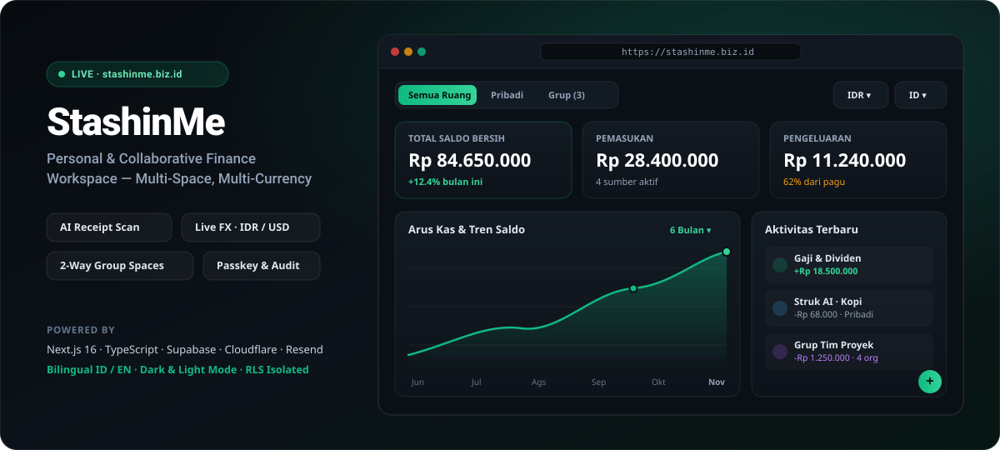

<div align="center">



# StashinMe

**Personal & Collaborative Finance Workspace — Multi-Space, Multi-Currency, AI Receipt Scanner**

[](https://stashinme.biz.id)
[](https://nextjs.org/)
[](https://www.typescriptlang.org/)
[](https://supabase.com/)
[](https://www.cloudflare.com/)

[Buka Aplikasi (`stashinme.biz.id`)](https://stashinme.biz.id) · [Privacy Policy](https://stashinme.biz.id/privacy) · [Terms of Service](https://stashinme.biz.id/terms) · [API Handoff Docs](docs/THIRD_PARTY_API_HANDOFF.md)

</div>

---

<p align="center">
  
</p>

## Fitur Utama

| Modul | Deskripsi |
| --- | --- |
| **Multi-Space Workspace** | Pisahkan keuangan **Semua Ruang**, **Pribadi**, dan **Grup Kolega** dalam satu dasbor terpadu dengan undangan grup 2 arah. |
| **AI Receipt Scanner** | Unggah foto struk langsung dari tombol cepat (`+`) untuk ekstraksi item, nominal, dan kategori otomatis. |
| **Multi-Currency & Live FX** | Konversi otomatis mata uang utama (`IDR`, `USD`, `SGD`, `EUR`, `JPY`, dll.) dengan kurs pasar real-time. |
| **Dompet, Pagu & Utang/Piutang** | Kelola rekening/e-wallet, batas anggaran bulanan, target tabungan, serta catatan piutang & cicilan. |
| **Keamanan & Audit Trail** | Autentikasi Email/Password, Google OAuth, Passkey/MFA, Cloudflare Turnstile, Row-Level Security (RLS), serta Audit Log 2 arah. |
| **Bilingual & Tema Adaptif** | Dukungan penuh Bahasa Indonesia & English (`next-intl`) serta Dark / Light mode. |
| **Membership & Admin Console** | Paket *Free*, *Standard*, *Pro*, *Business*, dan *Enterprise Custom* lengkap dengan panel kontrol admin & manajemen integrasi API. |

---

## Tech Stack

- **Framework:** Next.js 16 (App Router) + React 19 + TypeScript
- **Styling & UI:** Tailwind CSS v4 + Framer Motion + Lucide Icons
- **Auth & Database:** Supabase PostgreSQL + Row-Level Security (RLS)
- **Email & Security:** Resend Custom SMTP (`noreply@stashinme.biz.id`), Cloudflare Email Routing (`support@stashinme.biz.id`), Cloudflare Turnstile
- **Deployment:** Vercel (`https://stashinme.biz.id`)

---

## Setup Lokal & Deployment

### 1. Database (Supabase)

Buat project Supabase baru, lalu jalankan satu file migrasi ini di **Supabase → SQL Editor**:

```sql
supabase/migrations/2026-11-21_bootstrap_new_project.sql
```

File tersebut sudah mencakup seluruh skema tabel (profil, transaksi, pinjaman, pagu anggaran, dompet, kurs, KYC, kolega, storage, sosial), RLS + policy, role `admin`/`user`, dan seluruh `GRANT`.

Untuk memperbaiki hak akses jika tabel sudah ada:

```sql
supabase/migrations/2026-11-23_fix_missing_grants.sql
```

### 2. Environment Variables

Salin `.env.example` menjadi `.env.local` dan lengkapi variabel wajib:

| Variable | Keterangan |
| --- | --- |
| `SUPABASE_SERVICE_ROLE_KEY` | Kunci service role Supabase (server-only). **Jangan pernah di-commit.** |
| `SUPERADMIN_USERNAME` | Username login superadmin (tanpa `@`). |
| `SUPERADMIN_PASSWORD_HASH` | Hash password superadmin (hasil `npm run hash-password`). |
| `JWT_SECRET` | Kunci penandatanganan sesi, minimal 32 karakter. |
| `NEXT_PUBLIC_TURNSTILE_SITE_KEY` | Site key Cloudflare Turnstile. |
| `TURNSTILE_SECRET_KEY` | Secret key Cloudflare Turnstile (server-only). |

### 3. Jalankan & Build

```bash
npm install
npm run dev          # server pengembangan (http://localhost:3000)
npm run typecheck    # cek TypeScript (tsc --noEmit)
npm run lint         # cek ESLint
npm run check:i18n   # validasi kunci terjemahan ID/EN
npm run build        # build production
```

---

## Catatan Arsitektur

- **Strict Error Checking:** Seluruh operasi tulis ke Supabase memvalidasi `{ error }` secara eksplisit sehingga tidak ada kegagalan diam-diam.
- **Timezone Consistency:** Seluruh format tanggal dikunci ke zona waktu aplikasi (`Asia/Jakarta`) via `Intl.DateTimeFormat` untuk mencegah React hydration mismatch.
- **Third-Party Integrations:** Panduan integrasi Stripe, Midtrans, Resend, dan e-KYC tersedia di [`docs/THIRD_PARTY_API_HANDOFF.md`](docs/THIRD_PARTY_API_HANDOFF.md).

---

## Kontak & Legal

- **Website:** https://stashinme.biz.id
- **Support & Partnership:** support@stashinme.biz.id
- **Privacy Policy:** https://stashinme.biz.id/privacy
- **Terms of Service:** https://stashinme.biz.id/terms
